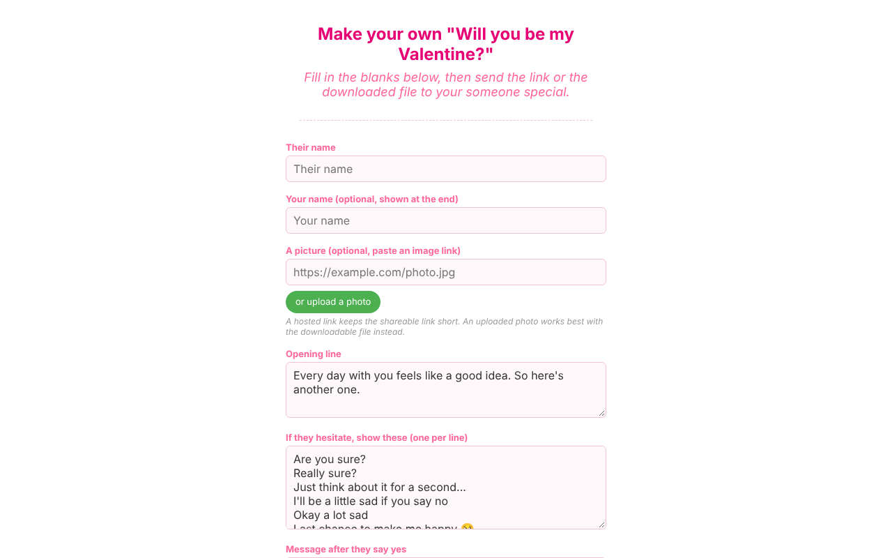

<div align="center">

# 💌 Valentine Page with Response Notifications

The Valentine page with a unique Valentine ID and an optional Telegram message the moment the recipient presses **Yes** or **No**.

[](https://meshannawod.github.io/interactive-proposal-website/)

   



</div>
> Newer versions: **[interactive-proposal-website-v2](https://github.com/MeshanNawod/interactive-proposal-website-v2)** and **[will-you-be-my-valentine](https://github.com/MeshanNawod/will-you-be-my-valentine)**.

## Files

- `valentine-full-notification.html` — the Valentine page you send to the recipient.
- `response-server.php` — your private server endpoint. It receives the response and sends a Telegram message.

---

# How it works

```text
You create Valentine
        ↓
Unique Valentine ID is generated
        ↓
Send the HTML file through WhatsApp
        ↓
Recipient opens the file
        ↓
Recipient presses YES
        ↓
HTML sends response to your PHP server
        ↓
PHP server sends Telegram notification
        ↓
You receive: ❤️ Valentine Response — YES
```

The Telegram bot token is **never placed inside the HTML file**.

---

# 1. Create a Telegram bot

Open Telegram and search for:

`@BotFather`

Send:

`/newbot`

Follow the instructions.

BotFather will give you a token similar to:

```text
123456789:AAExampleBotTokenxxxxxxxxxxxxxxxx
```

Keep this token private.

---

# 2. Get your Telegram Chat ID

Start a chat with your new bot and send it any message, for example:

```text
hello
```

Then open:

```text
https://api.telegram.org/botYOUR_BOT_TOKEN/getUpdates
```

Replace `YOUR_BOT_TOKEN` with your actual bot token.

Look for:

```json
"chat": {
    "id": 123456789
}
```

The number is your `CHAT_ID`.

If you use a Telegram group instead, add the bot to the group and use the group's chat ID.

---

# 3. Configure response-server.php

Open:

```text
response-server.php
```

Find:

```php
$BOT_TOKEN = "PUT_YOUR_TELEGRAM_BOT_TOKEN_HERE";
$CHAT_ID   = "PUT_YOUR_TELEGRAM_CHAT_ID_HERE";
```

Replace them with your real values:

```php
$BOT_TOKEN = "123456789:AAxxxxxxxxxxxxxxxx";
$CHAT_ID   = "123456789";
```

⚠️ Never upload a PHP file containing your bot token to a public GitHub repository.

---

# 4. Upload the PHP file

You need a server that supports:

- PHP
- HTTPS
- cURL enabled

Upload:

```text
response-server.php
```

For example, if your domain is:

```text
https://example.com/
```

and you upload the file to the root directory, the endpoint becomes:

```text
https://example.com/response-server.php
```

---

# 5. Put the server URL into the HTML

Open:

```text
valentine-full-notification.html
```

Find:

```javascript
RESPONSE_API_URL: "",
```

Change it to:

```javascript
RESPONSE_API_URL: "https://example.com/response-server.php",
```

Use your actual HTTPS URL.

---

# 6. Test it

Open the HTML in a browser.

Create a Valentine and download/send the HTML.

Open the sent file as the recipient.

Press:

```text
YES
```

You should receive a Telegram message similar to:

```text
❤️ Valentine Response

Response: YES
Recipient: Sarah
Valentine ID: 8f7c...
Time: 2026-10-07T...
Sender: Meshan
```

---

# Important: WhatsApp forwarding

The HTML file contains its own Valentine data and unique ID.

Therefore, if someone forwards the exact same HTML file:

```text
You
 ↓
Sarah
 ↓
forwards HTML
 ↓
Another person
```

the forwarded copy still has the same Valentine ID.

So the notification tells you:

> **This particular Valentine copy received YES.**

It does **not** prove the physical identity of the person who pressed the button.

A standalone HTML file cannot reliably know who opened it.

---

# Why the Telegram token is not in the HTML

Do NOT do this:

```javascript
var BOT_TOKEN = "123456...";
```

inside the HTML.

Anyone receiving the file could extract the token and abuse your Telegram bot.

Instead:

```text
HTML
  ↓
your PHP endpoint
  ↓
Telegram API
```

The secret token stays on your server.

---

# Security notes

This system is designed for a fun Valentine project, not high-security authentication.

The recipient can technically inspect the HTML and network requests.

The unique ID is an identifier, **not a secret authentication credential**.

The PHP endpoint also accepts responses from the internet, so anyone who knows the endpoint could technically send a fake request.

For a stronger system, use:

```text
unique secret token
        +
server-side database
        +
one-time response token
        +
HTTPS
```

That would make the response system much harder to spoof.

---

# Offline behavior

If the recipient opens the HTML while completely offline, the Valentine itself still works.

However:

```text
YES → Telegram notification
```

requires an internet connection.

If the notification request fails, the Valentine page does **not** break.

---

# Repeated YES presses

The HTML stores a small local browser flag after the first response.

By default:

```javascript
BLOCK_REPEAT_RESPONSES: true
```

This prevents repeated notifications from the same browser.

It is only a convenience feature, not security.

---

# Custom notification

The PHP server can later be changed to support:

- Telegram
- Email
- Database logging
- Discord webhook
- Your own dashboard
- Multiple recipients
- Response history
- Exact server timestamp

---

## Recommended setup

For your WhatsApp HTML-file use case, I recommend:

```text
HTML file
   ↓
HTTPS PHP endpoint
   ↓
Telegram Bot
   ↓
📱 Your phone
```

This keeps your current downloadable-file idea while giving you an immediate notification when the recipient presses **YES**.

## License

This project is licensed under the GNU General Public License v2.0 or later (GPL-2.0-or-later). See [LICENSE](LICENSE).
